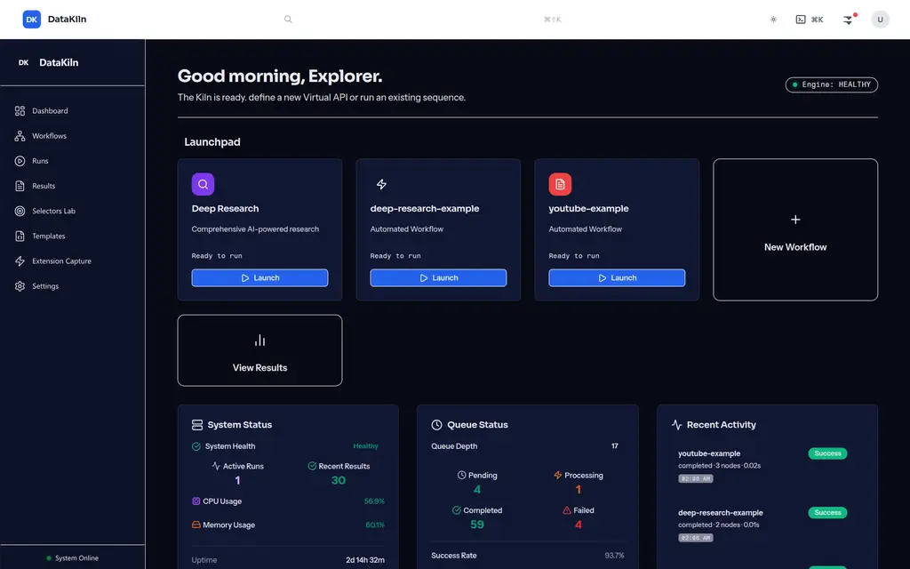
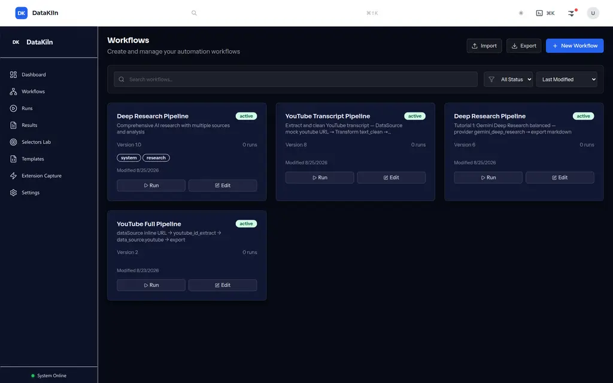
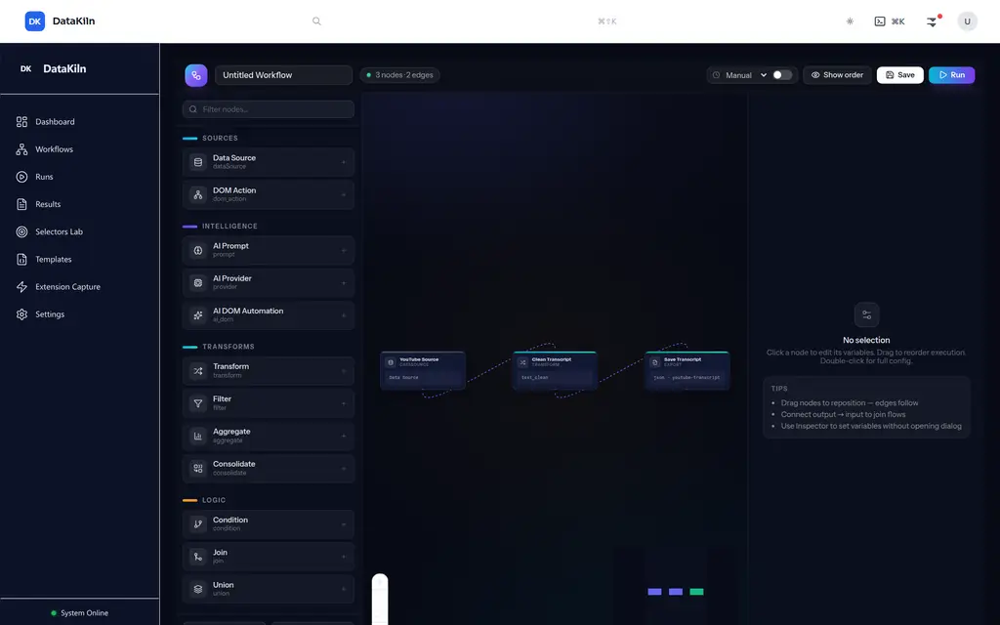
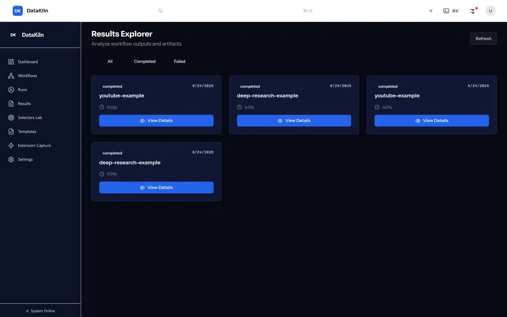

# DataKiln — Visual Workflow Automation for Free 24/7 Execution

<p align="center">
  
  
  
  
  
</p>

<p align="center"><i>Script what you repeat. Replace token-billed repetition with free programmatic execution — including AI tasks via the HTML web interface instead of the API — so 24/7 limited-resource models get more done.</i></p>

---

## Screenshots

| Dashboard — Engine & Launchpad | Workflows — Library |
|---|---|
|  |  |
| **Aurora Editor — Data Source → Transform → Export** | **Results Explorer** |
|  |  |

> Aurora dark shell (`#070A14` / `#0B0F1E`), `Sora` + `Instrument Sans` + `Fragment Mono`, `React Flow` canvas with glass nodes and glow.

---

## What this is

DataKiln is a **local, power-user workflow builder** — not a generic agent. You define a repetitive task once (site + selectors + variables all known up front), save it as a workflow, then re-run it with one click as a script. No LLM agent in the loop unless you explicitly want one.

* **Predefined only** — the site and DOM element names are part of the workflow definition. It does not discover sites on the fly; that's out of scope by design.
* **Free repetition** — an AI research run can go through the **HTML web UI** (`gemini.google.com/app` via `dom.sequence`) instead of the billable API (`provider` → `llm.chat`). Same output, zero tokens. That is the 24/7 leverage.
* **Layered model** — `atoms` (single DOM/data actions) → `molecules` (reusable site groups like "submit prompt to Gemini") → `substances` (full report pipelines). `Subgraph` / `SubgraphInvocation` in the schema; editor save/load of grouped patterns is next.

---

## What works today (2026-08-25, `main` `f9edd13` → `da6827f` Aurora → refinements)

**Core loop verified end-to-end (vision + API):**
`Define in Aurora editor → Save → One-click Run → Results/Artifacts`

* **Editor** — palette `Data Source / DOM Action / AI Prompt / AI Provider / AI DOM Automation / Transform / Filter / Aggregate / Consolidate / Condition / Join / Union / Export` (13 types), drag + click to add, `Handle` output→input joining, right **Inspector** live variable editing (`mock_data`, `template`, `filename/format`, `provider_type`/`research_depth`/`query`, `delay_ms`), `EXECUTION ORDER — DRAG TO REORDER`, `Import`/`Export` JSON, `Save` → `POST /api/v1/workflows`, `Run` → `POST /api/v1/workflows/execute` (seen `bf7c134e` `a86ab21a` `2eae6523…` `completed` in Results).
* **Executor** — typed layered schema `Port / NodeDef / Subgraph / WorkflowComposition → ExecutionPlan` (`backend/app/models/workflow_schema.py`), `WorkflowExecutor` with `logic.merge`/`transform.markdown`/`control.delay`/`export.file`/`data_source.inline|web|youtube`/`code.youtube_id_extract`, generic `dom.sequence` wired for any site (`dom_action → dom.sequence` 14edf6b, dry-run `[goto, click]` verified).
* **Scheduler** — `schedule_interval_seconds` / `schedule_enabled` on `Workflow`, `SchedulerService` 30s poll (`backend/app/services/scheduler_service.py`), `PUT/GET /api/v1/workflows/{id}/schedule`, editor header `Manual / Every 1m/5m/1h/Daily` toggle, verified `scheduler-test-30s` firing `total 1 → 2` unattended.
* **Durability** — workflow definitions persisted as `backend/data/workflows/*.json`; run history now persisted to `backend/data/runs.json` (survives restart, shown `total 1 durability-test` after restart). SQLite is next.
* **Auth** — `scripts/capture_auth_state.py --url https://gemini.google.com/app --out storage_state.json` (headed Playwright) for the free HTML-AI path; `storage_state_path` already wired in `execute_dom_sequence`.
* **WebUX** — `Dashboard` Engine `HEALTHY` + Launchpad + `Queue Depth 17` + `Recent Activity` from real runs (no more `Activity 1` placeholders), `Workflows` grid (4 authentic pipelines), `Results Explorer` `completed` cards, `Selectors Lab`/`Templates` load clean. `GET /api/v1/results/stats/top` added to fix white skeleton cards.

**Example workflows that build and `completed`:**
* `Deep Research — Renewable Energy`: `AI Provider gemini_deep_research balanced` → `Export markdown renewable-energy-research.md`
* `YouTube Transcript Pipeline`: `Data Source mock https://www.youtube.com/watch?v=dQw4w9WgXcQ` → `Transform text_clean` → `Export json youtube-transcript`

**Gates:** `backend 111 passed` `frontend tsc EXIT 0` `vite build ✓` (in `main`).

### Still in progress (honest)

* **Live provider proof** — one real `dom.gemini.deep_research` run with captured auth against a live session (selectors currently `rich-textarea [contenteditable]`, `button[aria-label*='Send']`).
* **Selector versioning** — `selectors.json` is versioned but without `last_success` tracking.
* **Molecule save/load** — schema supports `Subgraph` but editor has no grouped-pattern save.
* **YouTube transcript live fetch** — `youtube_transcript_api` path works but `youtubetotranscript.com` hits Cloudflare headless; `data_source.youtube` is dry-run until the transcript site fallback is hardened.
* **No external cron** — scheduler is in-process interval only, not system cron.

> `AUTHORITATIVE_STATUS_NOTES.md` supersedes any `100% COMPLETE` claim until the release gate checklist is green.

---

## Quick start

```bash
git clone https://github.com/aaaronmiller/datakiln.git
cd datakiln

# Backend
cd backend
python3 -m venv venv && source venv/bin/activate
pip install -r requirements.txt
# optional: capture auth for free Gemini web UI
python ../scripts/capture_auth_state.py --url https://gemini.google.com/app --out ../storage_state.json
uvicorn app.main:app --host 0.0.0.0 --port 8000

# Frontend (new terminal)
cd frontend
npm install
npm run dev        # http://localhost:3001  (Vite, HMR)

# Chrome extension (optional)
# Chrome → Extensions → Developer mode → Load unpacked → chrome-extension/
```

---

## Architecture

```
                ┌─────────────┐     ┌──────────────────┐     ┌──────────────┐
                │  Chrome     │     │  Frontend        │     │  Backend     │
                │  Extension  │◄──► │  React + Vite    │◄──► │  FastAPI     │
                │  dual mode  │     │  React Flow      │     │  25+ endpoints│
                │  capture    │     │  Aurora editor   │     │  Scheduler   │
                └──────┬──────┘     └────────┬─────────┘     └──────┬───────┘
                       │                     │                      │
                       └─────────────────────┼──────────────────────┘
                                             │
                              ┌────────────────────────┐
                              │  Executor              │
                              │  dag_executor +        │
                              │  Scheduler 30s poll    │
                              │  dom.sequence dry-run  │
                              │  runs.json durable     │
                              └────────────────────────┘
```

* **Frontend** — `React 18` + `Vite` + `@xyflow/react` + `Zustand` + `Tailwind v3` (Aurora tokens).
* **Backend** — `FastAPI` + `DAGExecutor` + `SchedulerService` + `WorkflowPersistenceService` (JSON) + `ArtifactService` + `ProviderManager`.
* **Persistence** — `backend/data/workflows/*.json` (definitions), `backend/data/runs.json` (history), `data/outputs/` (artifacts).

---

## Node types

`Data Source` (`mock`/`inline`/`url`/`youtube`) · `DOM Action` (`click`/`fill`/`goto`/`extract`/`copy`/`waitForVisible`) · `AI Prompt` · `AI Provider` (`gemini_deep_research`/`gemini_canvas`/`perplexity`) · `AI DOM Automation` · `Transform` (`markdown`/`text_clean`/`json_transform`…) · `Filter` · `Aggregate` (`count`/`sum`/`avg`…) · `Consolidate` · `Condition` (`DKEL`) · `Join` · `Union` · `Export` (`json`/`markdown`/`yaml`/`csv`/`txt` + `Obsidian`)

`dom_action` executes as `dom.sequence` — any predefined sequence without an LLM.

---

## API

```
POST   /api/v1/workflows                          # create
PUT    /api/v1/workflows/{id}                     # update
GET    /api/v1/workflows                          # list
GET    /api/v1/workflows/{id}                     # get
PUT    /api/v1/workflows/{id}/schedule            # {schedule_interval_seconds, schedule_enabled}
GET    /api/v1/workflows/{id}/schedule
POST   /api/v1/workflows/execute                  # {workflow, validate_workflow, execution_options}
POST   /api/v1/workflows/{id}/schedule            # alias for above
GET    /api/v1/results                            # paginated {results, pagination}
GET    /api/v1/results/{execution_id}
GET    /api/v1/results/stats/top?limit=5
GET    /api/v1/dashboard/system-status
GET    /api/v1/dashboard/recent-activity
GET    /api/v1/dashboard/queue-status
WS     /ws/dashboard  /ws/executions/{id}
```

---

## Project structure

```
datakiln/
├── frontend/               # Aurora editor (React + Vite)
│   ├── src/components/workflow/  # WorkflowEditor, WorkflowNode, AiDomNode
│   ├── src/pages/          # Dashboard, Workflows, Runs, Results, Selectors Lab
│   └── src/types/workflow-fixed.ts  # Node registry (13 types)
├── backend/
│   ├── app/services/       # workflow_service, scheduler_service, artifact_service
│   ├── app/models/workflow_schema.py  # layered schema + NodeDefs
│   ├── dag_executor.py     # planner + executors (dom.sequence wired)
│   └── data/workflows/     # persisted definitions (gitignored)
├── chrome-extension/       # dual-mode capture (Website vs Clipboard)
├── scripts/                # capture_auth_state.py  youtube_transcript.py  deep_research.py
└── docs/
    ├── screenshots/        # 01-dashboard 02-workflows 03-editor 04-results (webp)
    └── reference/datakiln-copy/  # retrieved unique artifacts from parallel fork
```

---

## Development

```bash
# Gates (must pass before push)
cd backend && venv/bin/python -m pytest backend/tests -q   # 111 passed
cd frontend && npx tsc --noEmit                             # EXIT 0
cd frontend && npm run build                                # vite build

# Repo state as of 2026-08-25
git log --oneline -4
# f9edd13 refine: scheduler, durable runs, and auth capture
# 14edf6b fix: wire generic DOM Action for predefined scripting
# da6827f design(aurora): rebuild workflow editor
# 03e526f merge: unified frontend(copy) + backend(og)
```

`docs/reference/datakiln-copy/` preserves every unique artifact from the parallel `datakiln copy` fork (50 files: `youtube-content.js`, `workflow-templates.json`, 15+ backend tests, `providers_legacy.py`, `prompt_templates.json`, docs, `cli.py`). Safe to remove the original `../datakiln copy` folder — nothing of value remains there.

---

*Built for models that repeat — script once, run free forever.*
